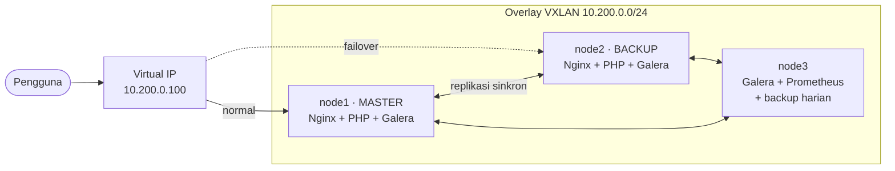

<h1 align="center">High Availability Multi Node</h1>

<p align="center">
  <b>Tiga server yang saling menggantikan: kalau satu mati, website tetap jalan dalam ±3 detik, tanpa campur tangan admin.</b><br>
  Keepalived (VRRP) + MariaDB Galera Cluster + Nginx, di atas overlay VXLAN. Proyek skripsi S1 Teknik Informatika (2026).
</p>

<p align="center">
  
  
  
  
</p>

<p align="center">
  <a href="#hasil-pengujian"><b>Hasil pengujian</b></a> ·
  <a href="#arsitektur">Arsitektur</a> ·
  <a href="#isi-repo">Isi repo</a> ·
  <a href="#mulai-cepat">Mulai cepat</a> ·
  <a href="#dokumentasi">Dokumentasi</a> ·
  <a href="#english-summary">English</a>
</p>



## Tentang

Sistem pengajuan judul tugas akhir di kampus berjalan di **satu server** tanpa cadangan. Saat server itu bermasalah, layanan tidak bisa diakses sekitar **3 jam** dan harus dipulihkan manual oleh admin.

Proyek ini membangun penggantinya di **tiga VPS**:

- **Keepalived** memindahkan Virtual IP ke node2 kalau node1 mati, atau kalau Nginx di node1 gagal menjawab `/sehat` dua kali berturut-turut.
- **MariaDB Galera Cluster** mereplikasi data secara sinkron ke tiga node. Node ketiga menjaga kuorum supaya tidak terjadi *split-brain*.
- **Prometheus + Grafana** memantau ketiga node, dan `mariabackup` mencadangkan basis data setiap hari.

Hal yang paling menarik: jaringan penyedia cloud **menyaring ARP ke Virtual IP**, sehingga failover biasa tidak jalan. Solusinya adalah membangun **overlay VXLAN** dan menjalankan VRRP di dalamnya. Ceritanya lengkap di [docs/VXLAN.md](docs/VXLAN.md).

- **Status:** arsip penelitian skripsi (2026). Repo ini mendokumentasikan sistem seperti saat diuji.
- **Aplikasi:** replika simulasi dengan data buatan. Semua kata sandi sudah diganti placeholder.

## Hasil pengujian

| Pengujian | Hasil |
|---|---|
| Failover saat **node mati mendadak** (5 percobaan) | rata-rata **3,25 detik** |
| Failover saat **Nginx berhenti** (5 percobaan) | rata-rata **5,06 detik**, kembali ke node1 dalam 0,55 detik |
| **100 pengguna simultan** (JMeter, 1.000 permintaan) | waktu tanggap rata-rata **21 ms**, **0%** gagal |
| Konsistensi data | replikasi sinkron di 3 node, dan node yang pulih bergabung lagi lewat IST |
| **Ketersediaan** selama 24 jam pengujian | **99,9519%** (41,55 detik tidak tersedia) |

Waktu pemulihan per kejadian turun dari **sekitar 1–2 jam dan manual** menjadi **3–5 detik dan otomatis**. Rincian tiap percobaan, sumber setiap angka, dan alasan angka ketersediaan sistem lama tidak bisa dibandingkan langsung ada di [docs/HASIL-PENGUJIAN.md](docs/HASIL-PENGUJIAN.md). Log mentahnya ada di [`hasil-uji/log-pengujian.txt`](hasil-uji/log-pengujian.txt).

## Arsitektur

| Node | IP overlay | Peran |
|---|---|---|
| node1 | 10.200.0.1 | **MASTER**: Nginx + PHP-FPM + MariaDB Galera, Keepalived prioritas 200 |
| node2 | 10.200.0.2 | **BACKUP**: sama seperti node1, Keepalived prioritas 100 |
| node3 | 10.200.0.3 | MariaDB Galera (kuorum), Prometheus + Grafana, pencadangan harian |
| Virtual IP | 10.200.0.100 | Alamat yang diakses pengguna, pindah otomatis saat failover |

Setiap web server memakai basis data di node-nya sendiri (`127.0.0.1`), dan Galera menjaga ketiganya tetap sama.

## Isi repo

```text
konfigurasi/
├── node1/   vxlan0.service, 70-galera-ifjudul.cnf, nginx-ifjudul.conf, keepalived.conf, cek_nginx.sh
├── node2/   (sama seperti node1, sebagai BACKUP)
└── node3/   vxlan0.service, 70-galera-ifjudul.cnf, prometheus.yml, backup_galera.sh, crontab.txt
skrip/
└── galera_autorecover.sh   # pulihkan klaster setelah ketiga node mati bersamaan
aplikasi/                   # aplikasi replika (PHP 8.3 + PDO)
hasil-uji/
└── log-pengujian.txt       # log failover, verifikasi klaster, backup, tcpdump, penyetelan
docs/                       # dokumentasi
```

| Berkas | Lokasi di server |
|---|---|
| `vxlan0.service` | `/etc/systemd/system/vxlan0.service` |
| `70-galera-ifjudul.cnf` | `/etc/mysql/mariadb.conf.d/70-galera-ifjudul.cnf` |
| `nginx-ifjudul.conf` | `/etc/nginx/sites-available/ifjudul` |
| `keepalived.conf`, `cek_nginx.sh` | `/etc/keepalived/` |
| `prometheus.yml` | `/etc/prometheus/prometheus.yml` |
| `backup_galera.sh`, `galera_autorecover.sh` | `/usr/local/bin/` |

## Mulai cepat

Butuh **tiga VPS Ubuntu 24.04 LTS** dalam satu jaringan privat. Urutannya:

```text
1. VXLAN (3 node)  →  2. Galera (node1 bootstrap, lalu node2 & node3)  →  3. Skema + aplikasi
→  4. Nginx (node1 & node2)  →  5. Keepalived (node1 & node2)  →  6. Prometheus  →  7. Backup
```

Perintah lengkap per langkah ada di [docs/PANDUAN-PEMASANGAN.md](docs/PANDUAN-PEMASANGAN.md). Sebelum mulai:

- ganti semua `GANTI_DENGAN_SANDI` dan `GANTI123` dengan sandi sendiri (sandi VRRP maksimal 8 karakter dan harus sama di node1 dan node2);
- sesuaikan IP privat (`10.10.x.x`) dan nama interface (`eth1`) dengan jaringanmu.

## Dokumentasi

| Dokumen | Isi |
|---|---|
| [HASIL-PENGUJIAN.md](docs/HASIL-PENGUJIAN.md) | Semua angka uji per percobaan, sumbernya, dan perhitungan ketersediaan |
| [VXLAN.md](docs/VXLAN.md) | Kenapa Virtual IP tidak terjangkau, dan bagaimana overlay VXLAN mengatasinya |
| [PANDUAN-PEMASANGAN.md](docs/PANDUAN-PEMASANGAN.md) | Langkah pemasangan per node, dari VXLAN sampai uji failover |
| [PEMULIHAN-TOTAL.md](docs/PEMULIHAN-TOTAL.md) | Cara kerja `galera_autorecover.sh` saat ketiga node mati bersamaan |

## Teknologi

Ubuntu 24.04 LTS · MariaDB 10.11 Galera Cluster · Keepalived (VRRP unicast) · Nginx · PHP 8.3-FPM · VXLAN · Prometheus · Grafana · mariabackup · Bash

## Kontak

Terbuka untuk pekerjaan di bidang **infrastruktur / DevOps / web**. Hubungi saya lewat [LinkedIn](https://www.linkedin.com/in/kantakhanigara).

## Lisensi

[MIT](LICENSE) © 2026 Kanta Khanigara

---

## English summary

A three-node high-availability setup for a PHP web app, built for my undergraduate thesis (2026). **Keepalived** (unicast VRRP) moves a Virtual IP between two web nodes, **MariaDB Galera Cluster** replicates data synchronously across all three, and **Prometheus + Grafana** monitor them. The cloud provider's network filtered ARP for the Virtual IP, so VRRP and the Virtual IP run inside a **VXLAN overlay**.

Measured results: automatic failover in 3.25 s on node failure and 5.06 s on web-service failure, 100 concurrent users at 21 ms average response with 0% errors, and 99.95% availability over the 24-hour test window. This repo holds the configs, scripts, a replica app with fake data, and the test logs. MIT licensed.
